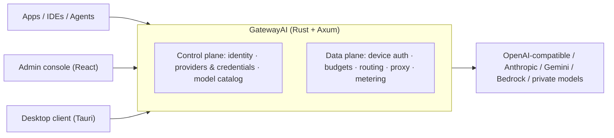

<div align="center">


# GatewayAI

**Open-source enterprise AI gateway: one OpenAI-compatible endpoint for every model — observable, governable, auditable.**

[简体中文](README.md) · English

[](https://github.com/Xiao-VoV/GatewayAI/actions/workflows/ci.yml)
[](LICENSE)
[](https://www.rust-lang.org/)
[](CONTRIBUTING.md)
[](https://github.com/Xiao-VoV/GatewayAI/stargazers)

[Why](#why-gatewayai) · [Features](#features) · [Architecture](#architecture) · [Quick Start](#quick-start) · [Contracts](#design-docs--api-contracts) · [Roadmap](#roadmap) · [Contributing](#contributing)

</div>

---

## Why GatewayAI

Connecting an app to an LLM API takes an afternoon. Running LLMs across an enterprise takes much longer:

- Dozens of teams hold their own API keys; the bill only shows up at month end.
- Keys copied from a laptop keep working after the employee leaves.
- Nobody can say which data went to which provider, or prove it to an auditor.
- One provider rate limit or account ban takes every product down at once.

**GatewayAI puts every model call behind one OpenAI-compatible endpoint and turns these problems into policies you can configure, audit and trace.**

| The problem you care about | How GatewayAI solves it |
|---|---|
| 💰 What did we spend, and who spent it | Budgets and quotas per user / device / model, with hard rejection on overspend; usage is recorded, rolled up daily and reconcilable |
| 🔐 Keys everywhere, leaving with people | Upstream credentials are encrypted at rest with AES-256-GCM and only returned masked; employees use per-device virtual keys that stop working when copied away |
| 🧾 How do we prove compliance | Request metadata logs and admin audit trails, no prompt/response bodies by default, consistent and exportable |
| 🛡 What if a provider fails | Multiple providers, accounts and routing targets with fallbacks, so a single outage is not fatal |
| 🏢 Can we self-host | A single Rust binary plus PostgreSQL, started with `docker compose`; no Redis or message queue required |

**Who it is for**: enterprise IT and platform teams that need to govern AI usage across teams; organizations that must self-host and pass compliance reviews; developers tired of wiring a different SDK for every project.

## Features

| Module | Capability | Status |
|---|---|---|
| Server foundation | Axum + sqlx + PostgreSQL; `/healthz`, `/readyz`, `/metrics`; `application/problem+json` error envelope; request-id / trace | ✅ Ready |
| Admin identity | First-run setup, login / logout, session + CSRF, Argon2id hashing, dual-counter rate limiting | ✅ Ready |
| Providers & credentials | Provider / account / upstream-model CRUD; AES-256-GCM encrypted credentials with masked read-back; connectivity test | ✅ Ready |
| Devices & virtual keys | Pairing codes, device registration, short-lived device tokens, one virtual key per device; immediate revoke / rotate | ✅ Ready |
| Budgets & rate limits | Per-user daily budgets, overspend rejection, readable 429s; RPM / TPM to follow | ✅ Ready |
| Model routing | Model aliases, multiple upstream targets, priority / weight / fallback candidates, visible-model projection | ✅ Ready |
| Proxy data plane | OpenAI Chat / Anthropic Messages, SSE streaming, timeouts and retries, protocol adaptation | ✅ Ready |
| Metering & auditing | Token / cost usage, daily rollups, request-log queries, admin audit events | ✅ Ready |
| Model catalog | Upstream model → deployment → model group → publication → client catalog | ✅ Ready |
| Admin console | 16 pages: identity, providers, catalog & publication, users/groups, virtual keys, device pairing, logs, audit, settings | ✅ Ready |
| Desktop client | Tauri 2 desktop + browser preview: pairing, model catalog & usage, local routing, AI tool config/rollback, tray/autostart | ✅ Ready |

## Architecture



- **Control plane**: operators manage identities, providers and credentials, and the model catalog from the admin API; state lives in PostgreSQL.
- **Data plane**: business requests arrive with a device token plus a virtual key, then pass authentication, budget checks, route selection, protocol proxying and usage metering.
- **One process**: a modular monolith shipped as a single binary; migrations run on startup.

Design documents are not public yet; public OpenAPI contracts live in [`contracts/`](contracts/).

## Quick Start

Requirements: Rust stable (edition 2024, 1.85+), Docker (local PostgreSQL); frontend needs Node.js 20+ and pnpm 11.

```bash
# 1. Start local PostgreSQL (development only, credentials in docker-compose.yml)
docker compose up -d postgres

# 2. Create the config file (defaults work out of the box)
cp server/.env.example server/.env

# 3. Start the server (listens on 127.0.0.1:8080)
cd server && cargo run
```

Health checks:

```bash
curl http://127.0.0.1:8080/healthz   # 200
curl http://127.0.0.1:8080/readyz    # 200; 503 when no database is configured
curl http://127.0.0.1:8080/metrics   # Prometheus text
```

Create the first administrator:

```bash
curl -X POST http://127.0.0.1:8080/api/admin/auth/setup \
  -H 'Content-Type: application/json' \
  -d '{"email":"admin@corp.example.com","password":"change-me-please-123","display_name":"Platform Admin"}'
```

> For production, set `GW_COOKIE_SECURE=true` and serve over HTTPS; enable `GW_SETUP_TOKEN` and `GW_MASTER_KEY` as needed. Full configuration is in [`server/.env.example`](server/.env.example).

### Admin console & client

```bash
pnpm install
pnpm dev:admin      # admin console at http://localhost:5173 (/api proxies to 8080)
pnpm dev:client     # browser preview at http://localhost:5175

# Desktop client (requires Rust and system Tauri dependencies; first build is slow)
pnpm --filter @gw/client desktop:dev
```

## Configuration

| Variable | Default | Description |
|---|---|---|
| `GW_BIND` | `127.0.0.1:8080` | Listen address |
| `GW_DATABASE_URL` (or `DATABASE_URL`) | empty | PostgreSQL connection string; empty disables the database (database-backed endpoints return 503) |
| `GW_LOG` | `gw_server=debug,tower_http=info` | Log filter |
| `GW_MIGRATE` | `true` | Run sqlx migrations on startup |
| `GW_COOKIE_SECURE` | `false` | Add `Secure` to the session cookie; must be `true` in production / behind HTTPS |
| `GW_SETUP_TOKEN` | empty | When set, first-run setup must send `X-Setup-Token` (use a high-entropy value of 16+ chars) |
| `GW_MASTER_KEY` | empty | Master key for encrypting upstream credentials (64 hex chars or 44 base64 chars, 32 bytes); required in production and must be backed up separately |
| `GW_MASTER_KEY_FILE` | `./data/master.key` | Master-key file path (relative to `server/`; mode 0600) |

See [`server/.env.example`](server/.env.example) for the complete list.

## Design-First

GatewayAI is built **design-first**: every module starts with a technical design, API semantics, database design and an OpenAPI contract, and only then gets implemented.

- Contracts and handlers are cross-checked by `contract_tests`; API changes must update `contracts/`.
- Migration scripts under `server/migrations/` map one-to-one to the database design.
- Public OpenAPI contracts live in `contracts/`; design documents are not public yet and will be opened progressively.

This convention lets external contributors see the boundaries before writing code, and makes every change traceable.

## Project Layout

```text
server/                 Rust server (Axum + sqlx + PostgreSQL)
  src/platform/         config, state, error envelope, database, health
  src/modules/          identity / providers / access / policy / routing / proxy / metering / observability / catalog / settings
  migrations/           sqlx migrations (0001…)
  deny.toml             dependency license allowlist (rejects CPAL / AGPL and similar)
apps/admin/             admin console (React 19 + Vite + TypeScript)
apps/client/            desktop client (React 19 + Vite + Tauri 2)
contracts/              per-module OpenAPI contracts (checked by contract_tests)
docker-compose.yml      local PostgreSQL (development only)
pnpm-workspace.yaml     pnpm workspace (apps/*)
.github/workflows/      CI: server (fmt/clippy/test/contracts/Postgres integration) / web (typecheck/build) / licenses / secret scan
```

## Design Docs & API Contracts

Module design documents are not public yet and will be opened progressively. Public OpenAPI contracts live in [`contracts/`](contracts/):

| Contract | Module |
|---|---|
| `contracts/identity.yaml` | Admin identity, sessions, CSRF, rate limits |
| `contracts/providers.yaml` | Providers, channel accounts, upstream models, credential encryption |
| `contracts/access.yaml` | Pairing codes, devices, device tokens, virtual keys |
| `contracts/policy.yaml` | Budgets, rate limits, overspend rejection |
| `contracts/routing.yaml` | Model aliases, multi-target routing, visible-model projection |
| `contracts/proxy.yaml` | OpenAI Chat / Anthropic Messages proxy |
| `contracts/metering.yaml` | Usage, cost, daily rollups |
| `contracts/observability.yaml` | Request logs, audit, CSV export |
| `contracts/catalog.yaml` | Model catalog and publication |
| `contracts/settings.yaml` | Platform settings |

## Roadmap

- [x] **v0.1.0**: server core (identity / providers / devices / keys / budgets / rate limits / routing / proxy / metering / audit / catalog / settings), admin console, desktop client
- [ ] **v0.1.x**: stability and compatibility hardening, more protocol adapters, documentation
- [ ] **v0.2**: multi-tenancy and quotas, audit & usage dashboards, deployment experience
- [ ] **Later**: Responses / Gemini / Bedrock adaptation, RAG, prompt management and agent tool governance

The roadmap communicates direction, not commitments; track progress via issues and releases.

## Contributing

All kinds of contributions are welcome: bug reports, feature requests, documentation improvements and code.

- Read [CONTRIBUTING.md](CONTRIBUTING.md) before opening a pull request.
- Read [CODE_OF_CONDUCT.md](CODE_OF_CONDUCT.md) before joining the community.
- For security issues, do not open a public issue — follow [SECURITY.md](SECURITY.md).
- Good entry points are issues labeled `good first issue` / `help wanted`.

## License

Released under the [GNU Affero General Public License v3.0](LICENSE) (AGPL-3.0).

```text
Copyright (C) 2026 The GatewayAI Authors
```

AGPL-3.0 allows commercial use and self-hosting; if you run a modified version as a network service, you must offer the corresponding source to its users. For closed-source integration or commercial licensing, contact the maintainers.

---

<div align="center">

**If GatewayAI helps your team, please consider giving it a ⭐ Star — it is the biggest encouragement for an open-source project.**

Built with 🦀 Rust · [Axum](https://github.com/tokio-rs/axum) · [sqlx](https://github.com/launchbadge/sqlx) · PostgreSQL

</div>
