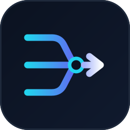
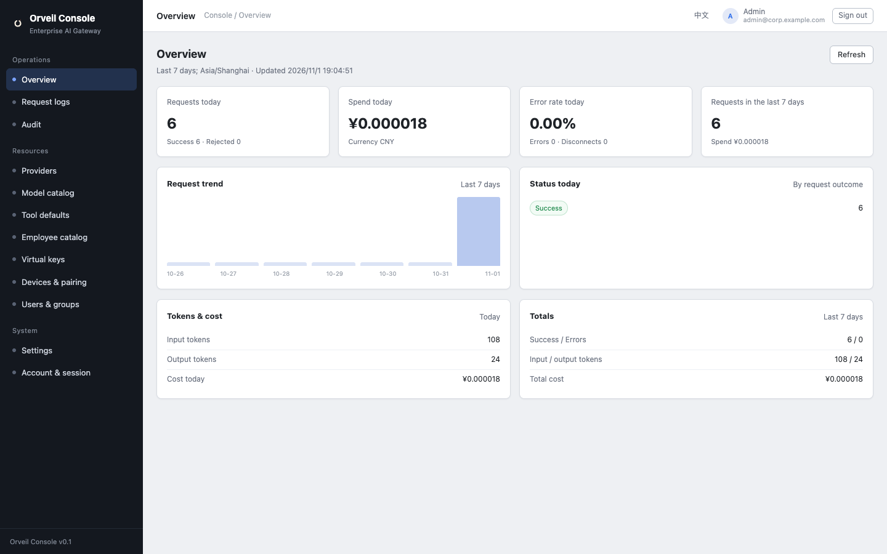
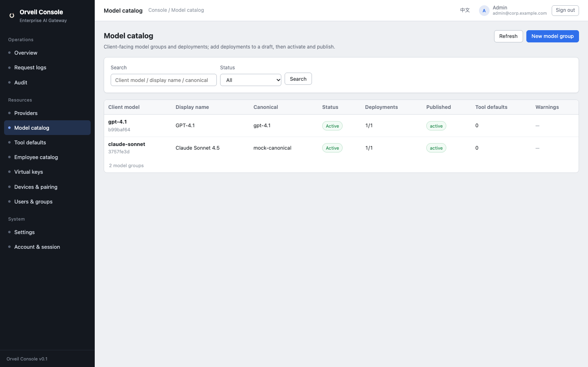
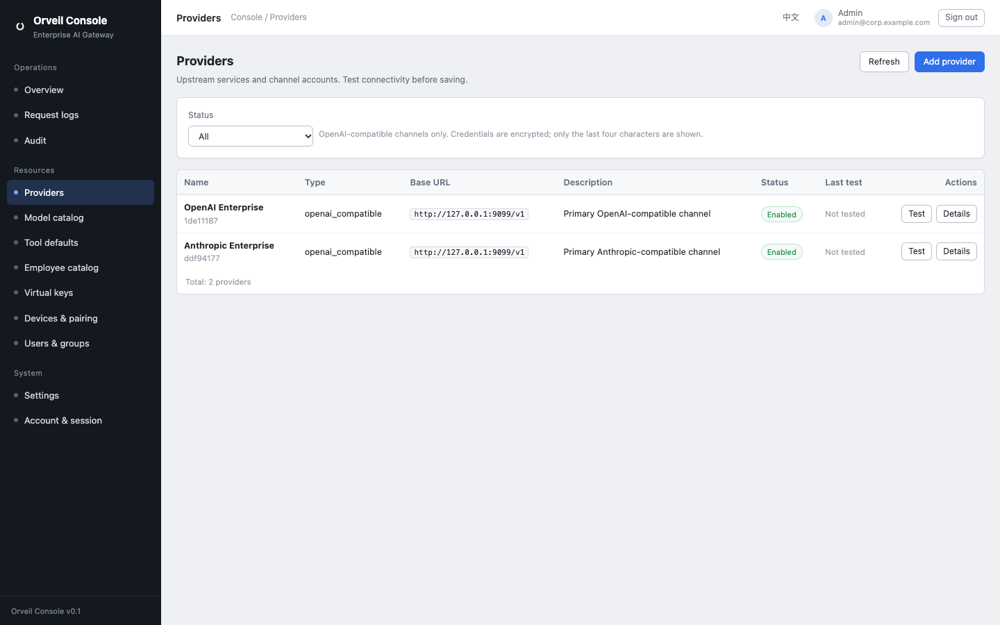
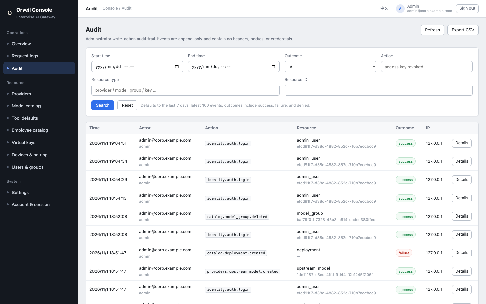
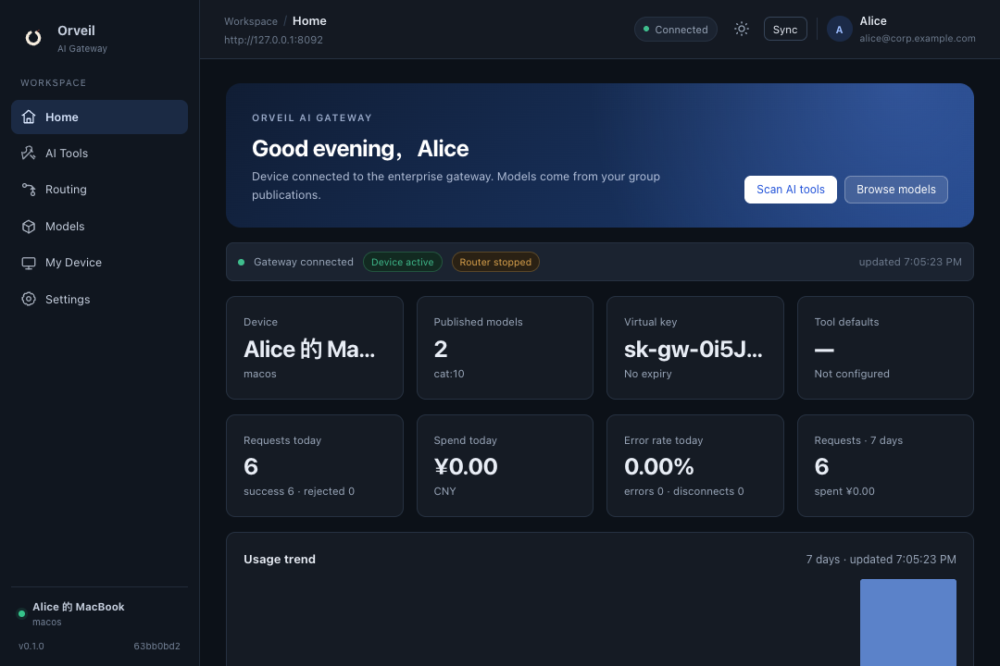
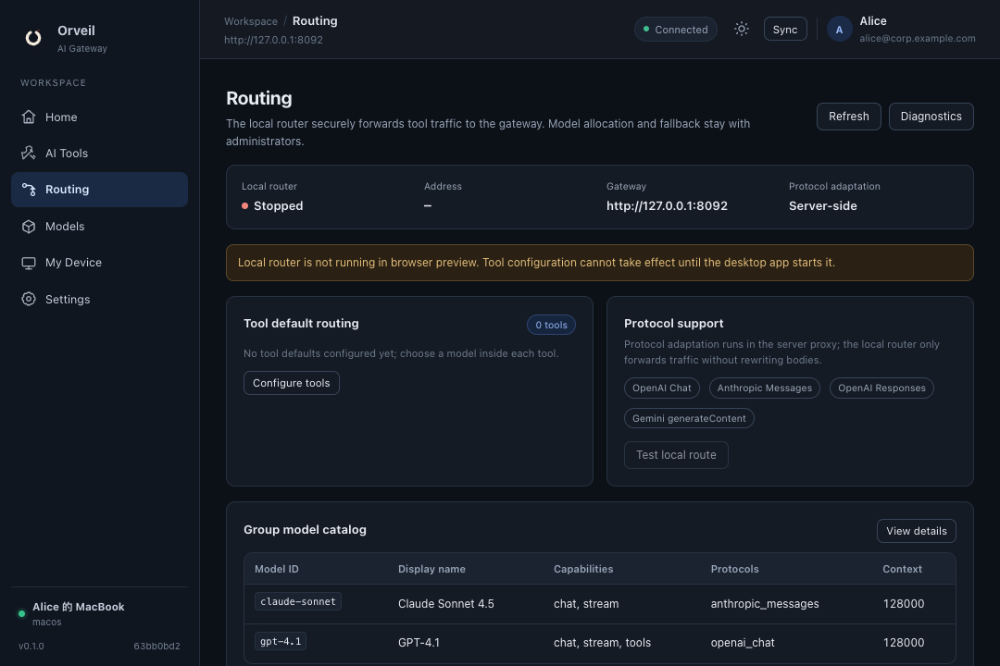
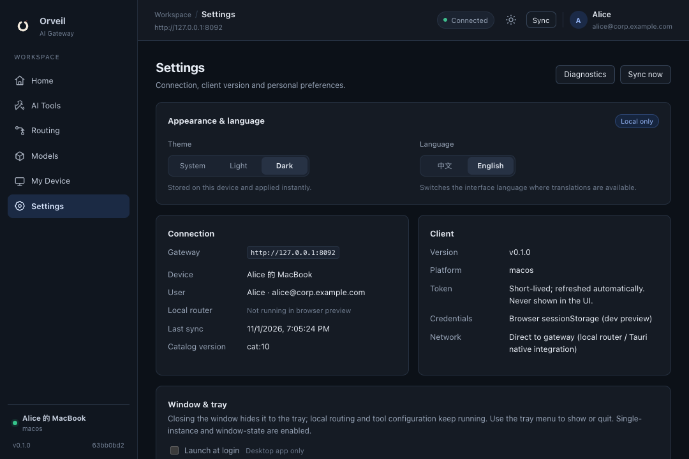
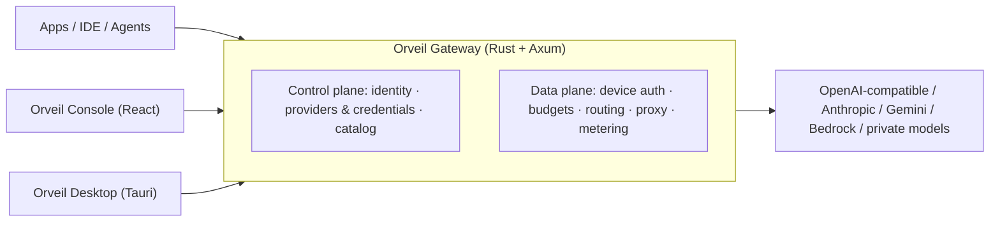

<div align="center">



# Orveil AI Gateway

**Orveil 帷幄 · Enterprise AI Gateway**

> Many models, one front door.

One OpenAI-compatible endpoint to connect, route, meter and govern every model call in your organization.

[简体中文](README.md) · English

[](https://github.com/Xiao-VoV/GatewayAI/actions/workflows/ci.yml)
[](LICENSE)
[](https://www.rust-lang.org/)
[](CONTRIBUTING.md)
[](https://github.com/Xiao-VoV/GatewayAI/stargazers)

[Product](#product) · [Interface](#interface) · [Features](#features) · [Architecture](#architecture) · [Quick Start](#quick-start) · [Contracts](#api-contracts) · [Roadmap](#roadmap)

</div>

---

## Why Orveil

The hard part of enterprise LLM adoption is not calling an API. It is what happens after:

- dozens of teams request their own keys, and the bill lands at the end of the month;
- a key copied from a laptop keeps working after the employee leaves;
- nobody can explain data flows or produce evidence for compliance reviews;
- one provider rate-limits or bans an account and every product goes down;
- every new AI tool needs the same endpoint, model and credential configured again.

**Orveil puts every model call behind one OpenAI-compatible endpoint and turns these problems into policies you can configure, audit and trace.**

| What you care about | How Orveil handles it |
|---|---|
| 💰 Who spent what | Per-user / device / model budgets and quotas; overspend is rejected. Usage records and daily rollups are reconcilable |
| 🔐 Keys everywhere | Upstream credentials are AES-256-GCM encrypted and only returned masked. Employees get one virtual key per device, useless if copied |
| 🧾 Compliance evidence | Request-metadata logs and admin audit trails, no prompt bodies by default; consistent and exportable |
| 🛡 Provider outages | Multiple providers, accounts, targets and fallback candidates; one supplier failure does not take everything down |
| 🖥 Onboarding local tools | Orveil Desktop pairs a device, scans local AI tools, writes configs and rolls them back precisely |
| 🏢 Private deployment | One Rust binary + PostgreSQL, started with `docker compose`; no Redis or message queue required |

**Who it is for**: IT and platform teams that need to govern AI usage across many teams; organizations that need private deployment and compliance evidence; engineering teams tired of integrating a different SDK for every project.

## Product

| Component | Description | Source |
|---|---|---|
| **Orveil Gateway** | Rust + Axum gateway: control plane, data plane, metering and audit | `server/` |
| **Orveil Console** | Admin console: providers, model catalog, devices, keys, budgets, logs, audit and settings | `apps/admin/` |
| **Orveil Desktop** | Tauri 2 desktop app: device pairing, catalog and usage, local router, AI-tool config and rollback | `apps/client/` |
| **Contracts** | Per-module OpenAPI contracts checked against the implementation by `contract_tests` | `contracts/` |

## Interface

### Orveil Console

<p align="center">
  
</p>

<p align="center">
  
  
</p>

<p align="center">
  
</p>

The console covers identity, providers and credentials, model catalog and publication, users and groups, virtual keys, device pairing, request logs, audit and settings. The UI is available in Chinese and English.

### Orveil Desktop

<p align="center">
  
</p>

<p align="center">
  
  
</p>

A native desktop window, not a web shell. Light and dark themes plus Chinese / English UI are built in.

## Features

| Module | Capability | Status |
|---|---|---|
| Server foundation | Axum + sqlx + PostgreSQL; `/healthz`, `/readyz`, `/metrics`; `application/problem+json` error envelope; request-id / trace | ✅ Available |
| Admin identity | First-run setup, login / logout, session + CSRF, Argon2id password hashing, dual-counter rate limits | ✅ Available |
| Providers & credentials | Provider / channel account / upstream model CRUD; AES-256-GCM credentials, masked responses; connectivity tests | ✅ Available |
| Devices & virtual keys | Pairing codes, device registration, short-lived device tokens, one virtual key per device; revoke / reset immediately effective | ✅ Available |
| Budgets & rate limits | Per-user daily budgets, overspend rejection, readable 429; RPM / TPM follow-up | ✅ Available |
| Model routing | Model aliases, multiple upstream targets, priority / weight / fallbacks, visible-model projection | ✅ Available |
| Data plane | OpenAI Chat / Anthropic Messages / Gemini generateContent / OpenAI Responses, SSE streaming, timeouts / retries, protocol adaptation | ✅ Available |
| Metering & audit | Usage / cost, daily rollups, request-log queries, admin audit trail | ✅ Available |
| Model catalog | Upstream model → deployment → model group → publication → client catalog | ✅ Available |
| Admin console | 16 pages: identity, providers, catalog and publication, users / groups, virtual keys, device pairing, logs, audit, settings | ✅ Available |
| Desktop client | Tauri 2 app + browser preview: pairing, catalog and usage, local router, AI-tool config and rollback, tray / autostart | ✅ Available |

## Architecture



- **Control plane**: administrators manage identity, providers, credentials and the catalog from Orveil Console; configuration lives in PostgreSQL.
- **Data plane**: each request carries a device token + virtual key; the gateway performs authentication, budget pre-check, route selection, protocol proxy and usage accounting.
- **One process**: a modular monolith; one binary to deploy, with migrations applied at startup.

## Quick Start

Requirements: Rust stable (edition 2024, 1.85+), Docker for local PostgreSQL; Node.js 20+ and pnpm 11 for the web apps.

```bash
# 1. Start local PostgreSQL (development only; credentials in docker-compose.yml)
docker compose up -d postgres

# 2. Generate local configuration
cp server/.env.example server/.env

# 3. Start the gateway (listens on 127.0.0.1:8080 by default)
cd server && cargo run
```

Health checks:

```bash
curl http://127.0.0.1:8080/healthz   # 200
curl http://127.0.0.1:8080/readyz    # 200; 503 without a database
curl http://127.0.0.1:8080/metrics   # Prometheus text
```

Create the first administrator:

```bash
curl -X POST http://127.0.0.1:8080/api/admin/auth/setup \
  -H 'Content-Type: application/json' \
  -d '{"email":"admin@corp.example.com","password":"change-me-please-123","display_name":"Platform Admin"}'
```

> For production, set `GW_COOKIE_SECURE=true` and use HTTPS. Enable `GW_SETUP_TOKEN` and `GW_MASTER_KEY` as needed. See [`server/.env.example`](server/.env.example).

### Run the console and client

```bash
pnpm install
pnpm dev:admin      # Orveil Console: http://localhost:5173 (proxies /api to 8080)
pnpm dev:client     # Browser preview: http://localhost:5175

# Desktop app (requires Rust and system Tauri dependencies; first build is slow)
pnpm --filter @gw/client desktop:dev
```

## Configuration

| Variable | Default | Description |
|---|---|---|
| `GW_BIND` | `127.0.0.1:8080` | Listen address |
| `GW_DATABASE_URL` (or `DATABASE_URL`) | empty | PostgreSQL URL; empty disables database-backed endpoints (503) |
| `GW_LOG` | `gw_server=debug,tower_http=info` | Log filter |
| `GW_MIGRATE` | `true` | Run sqlx migrations at startup |
| `GW_COOKIE_SECURE` | `false` | Add `Secure` to session cookies; must be `true` behind HTTPS |
| `GW_SETUP_TOKEN` | empty | When set, first-run setup requires `X-Setup-Token` (use ≥16 high-entropy chars) |
| `GW_MASTER_KEY` | empty | Master key for upstream credential encryption (32 bytes as 64 hex or 44 base64 chars); back it up separately |
| `GW_MASTER_KEY_FILE` | `./data/master.key` | Master-key file path relative to `server/` (0600) |

See [`server/.env.example`](server/.env.example) for the full list.

## Project Layout

```text
server/                 Rust gateway (Axum + sqlx + PostgreSQL)
  src/platform/         config, state, error envelope, database, health
  src/modules/          identity / providers / access / policy / routing / proxy / metering / observability / catalog / settings
  migrations/           sqlx migrations (0001…)
  deny.toml             Dependency license allowlist (rejects unsuitable licenses such as CPAL / AGPL)
apps/admin/             Admin console (React 19 + Vite + TypeScript)
apps/client/            Desktop client (React 19 + Vite + Tauri 2)
assets/                 Brand, screenshots and README assets
contracts/              Per-module OpenAPI contracts (checked by contract_tests)
docker-compose.yml      Local PostgreSQL (development only)
pnpm-workspace.yaml     pnpm workspace (apps/*)
.github/workflows/      CI: server (fmt/clippy/test/contracts/Postgres integration), web (typecheck/build), licenses, secret scan
```

## Engineering Principles

Orveil is built **design-first**: every module starts with technical design, API semantics, database design and an OpenAPI contract, and only then gets implemented.

- Contracts and implementation are cross-checked by `contract_tests`; API changes must update `contracts/`;
- Migration scripts in `server/migrations/` map one-to-one to database design;
- Public OpenAPI contracts live in `contracts/`.

This keeps boundaries visible to contributors and every change traceable.

## API Contracts

Public OpenAPI contracts live in [`contracts/`](contracts/):

| Contract | Module |
|---|---|
| `contracts/identity.yaml` | Admin identity, sessions, CSRF, rate limits |
| `contracts/providers.yaml` | Providers, channel accounts, upstream models and credential encryption |
| `contracts/access.yaml` | Pairing codes, devices, device tokens, virtual keys |
| `contracts/policy.yaml` | Daily budgets, rate limits, overspend rejection |
| `contracts/routing.yaml` | Model aliases, multi-target routing, visible-model projection |
| `contracts/proxy.yaml` | OpenAI Chat / Anthropic Messages proxy |
| `contracts/metering.yaml` | Usage, cost, daily rollups |
| `contracts/observability.yaml` | Request logs, audit, CSV export |
| `contracts/catalog.yaml` | Model catalog and publication |
| `contracts/settings.yaml` | Platform settings |

## Roadmap

- [x] **v0.1.0**: server core (identity / providers / devices / keys / budgets / rate limits / routing / proxy / metering / audit / catalog / settings), admin console and desktop client
- [x] **Orveil brand & desktop UI**: final naming, Ink Monogram icon, light/dark themes, Chinese/English UI
- [ ] **v0.1.x**: stability and compatibility hardening, more protocol adapters, Windows / Linux desktop validation
- [ ] **v0.2**: multi-tenant and quota policies, audit and usage dashboards, deployment experience
- [ ] **Later**: RAG, prompt management and agent tool-level governance

Roadmap is directional, not a commitment; progress lives in issues and releases.

## Contributing

Bug reports, feature requests, documentation improvements and code contributions are all welcome.

- Read [CONTRIBUTING.md](CONTRIBUTING.md) before submitting;
- Read [CODE_OF_CONDUCT.md](CODE_OF_CONDUCT.md) before joining the community;
- For security issues, do not open a public issue — follow [SECURITY.md](SECURITY.md);
- Good starting points are issues labeled `good first issue` or `help wanted`.

## License

Released under the [GNU Affero General Public License v3.0](LICENSE) (AGPL-3.0).

```text
Copyright (C) 2026 The Orveil Authors
```

AGPL-3.0 permits commercial use and self-hosting. If you offer a modified version as a network service, you must provide the corresponding source to its users. For closed-source integration or commercial licensing, contact the maintainers.

---

<div align="center">

**If Orveil helps your team, please consider giving it a ⭐ Star — it is the biggest encouragement for an open-source project.**

Built with 🦀 Rust · [Axum](https://github.com/tokio-rs/axum) · [sqlx](https://github.com/launchbadge/sqlx) · PostgreSQL

</div>
