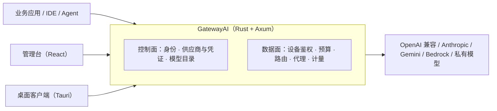

<div align="center">


# GatewayAI

**企业级 AI 网关：一个入口收口多家模型，让 AI 使用看得见、管得住、算得清。**

简体中文 · [English](README.en.md)

[](https://github.com/Xiao-VoV/GatewayAI/actions/workflows/ci.yml)
[](LICENSE)
[](https://www.rust-lang.org/)
[](CONTRIBUTING.md)
[](https://github.com/Xiao-VoV/GatewayAI/stargazers)

[为什么选择](#为什么选择-gatewayai) · [功能](#功能一览) · [架构](#架构) · [快速开始](#快速开始) · [设计文档](#设计文档与-api-契约) · [路线图](#路线图) · [参与贡献](#参与贡献)

</div>

---

## 为什么选择 GatewayAI

企业用大模型，真正难的不是「调通 API」，而是接入之后的一地鸡毛：

- 几十个团队各自申请 Key，月底才发现账单超支；
- 员工电脑里的 Key 拷走就能用，离职后仍能继续调；
- 数据流向说不清、等保检查拿不出证据；
- 某家供应商限流或封号，全线业务一起停摆。

**GatewayAI 用一个 OpenAI 兼容入口收口所有模型调用，把这些问题变成可配置、可审计、可回溯的策略。**

| 你关心的问题 | GatewayAI 的做法 |
|---|---|
| 💰 花了多少、谁花的 | 按用户 / 设备 / 模型的预算与配额，超支直接拒绝；用量记账、日聚合、可对账 |
| 🔐 Key 满天飞、离职带走 | 上游凭证 AES-256-GCM 加密入库，接口只回显掩码；员工使用「一设备一虚拟 Key」，拷走即失效 |
| 🧾 等保 / 备案怎么举证 | 请求元数据日志与管理操作审计，默认不落正文，口径统一、可导出 |
| 🛡 供应商故障怎么办 | 多供应商、多账号、多目标路由与降级，单家故障不致命 |
| 🏢 能不能私有化 | 单个 Rust 二进制 + PostgreSQL，`docker compose` 一条命令起步；不依赖 Redis / 消息队列 |

**适合谁**：需要统一管理多团队 AI 用量的企业 IT / 平台团队；要私有化部署、走合规流程的组织；以及想摆脱「每个项目各接一套 SDK」的研发团队。

## 功能一览

| 模块 | 能力 | 状态 |
|---|---|---|
| 服务端骨架 | Axum + sqlx + PostgreSQL；`/healthz`、`/readyz`、`/metrics`；`application/problem+json` 错误信封；request-id / trace | ✅ 可用 |
| 管理台身份 | 首次初始化、登录 / 登出、Session + CSRF、Argon2id 密码哈希、双计数限流 | ✅ 可用 |
| 供应商与凭证 | 供应商 / 渠道账号 / 上游模型 CRUD；AES-256-GCM 凭证加密与掩码回显；连通性测试 | ✅ 可用 |
| 设备与虚拟 Key | 配对码、设备注册、短期设备 token、一设备一虚拟 Key；吊销 / 重置即时生效 | ✅ 可用 |
| 预算与限流 | 用户日预算、超支拒绝、可读 429；RPM / TPM 后续补齐 | ✅ 可用 |
| 模型路由 | 模型别名、多上游目标、优先级 / 权重 / 降级候选、可见模型投影 | ✅ 可用 |
| 代理数据面 | OpenAI Chat / Anthropic Messages、SSE 流式、超时重试、协议适配 | ✅ 可用 |
| 计量与审计 | 请求用量 / 成本、日聚合、请求日志查询、管理操作审计 | ✅ 可用 |
| 模型目录 | 上游模型 → 部署 → 模型组 → 发布 → 客户端目录 | ✅ 可用 |
| 管理台 | 16 个页面：身份、供应商、模型目录与发布、用户/组、虚拟 Key、设备配对、日志、审计、设置 | ✅ 可用 |
| 桌面客户端 | Tauri 2 桌面端 + 浏览器预览：设备配对、模型目录与用量、本地路由、AI 工具配置与回滚、托盘/自启 | ✅ 可用 |

## 架构



- **控制面**：管理员通过管理台维护身份、供应商与凭证、模型目录，配置下发；数据只落 PostgreSQL。
- **数据面**：业务请求携带「设备 token + 虚拟 Key」进入网关，依次完成鉴权、预算预检、路由选择、协议代理与用量记账。
- **一个进程**：模块化单体，单二进制部署；数据库迁移随启动自动执行。

设计文档暂未开源；公开 API 契约见 [`contracts/`](contracts/)。

## 快速开始

依赖：Rust stable（edition 2024，需 1.85+）、Docker（本地 PostgreSQL）；前端需要 Node.js 20+ 与 pnpm 11。

```bash
# 1. 启动本地 PostgreSQL（仅开发用，账号密码见 docker-compose.yml）
docker compose up -d postgres

# 2. 生成配置（默认值可直接跑）
cp server/.env.example server/.env

# 3. 启动服务端（默认监听 127.0.0.1:8080）
cd server && cargo run
```

健康检查：

```bash
curl http://127.0.0.1:8080/healthz   # 200
curl http://127.0.0.1:8080/readyz    # 200；无数据库时为 503
curl http://127.0.0.1:8080/metrics   # Prometheus 文本
```

首次使用先初始化管理员：

```bash
curl -X POST http://127.0.0.1:8080/api/admin/auth/setup \
  -H 'Content-Type: application/json' \
  -d '{"email":"admin@corp.example.com","password":"change-me-please-123","display_name":"平台管理员"}'
```

> 生产部署请设置 `GW_COOKIE_SECURE=true` 并使用 HTTPS；按需开启 `GW_SETUP_TOKEN` 与 `GW_MASTER_KEY`。完整配置见 [`server/.env.example`](server/.env.example)。

### 管理台与客户端

```bash
pnpm install
pnpm dev:admin      # 管理台 http://localhost:5173（/api 代理到 8080）
pnpm dev:client     # 浏览器预览 http://localhost:5175

# 桌面客户端（需要 Rust 与系统 Tauri 依赖，首次编译较慢）
pnpm --filter @gw/client desktop:dev
```

## 配置

| 变量 | 默认 | 说明 |
|---|---|---|
| `GW_BIND` | `127.0.0.1:8080` | 监听地址 |
| `GW_DATABASE_URL`（或 `DATABASE_URL`） | 空 | PostgreSQL 连接串；留空则不启用数据库（依赖数据库的端点返回 503） |
| `GW_LOG` | `gw_server=debug,tower_http=info` | 日志过滤 |
| `GW_MIGRATE` | `true` | 启动时自动执行 sqlx 迁移 |
| `GW_COOKIE_SECURE` | `false` | Session Cookie 是否加 `Secure`；生产 / HTTPS 必须 `true` |
| `GW_SETUP_TOKEN` | 空 | 非空时初始化管理员必须携带 `X-Setup-Token`（建议 ≥16 字符高熵值） |
| `GW_MASTER_KEY` | 空 | 上游凭证加密主密钥（64 位 hex 或 44 字符 base64，32 字节）；生产必须预置并单独备份 |
| `GW_MASTER_KEY_FILE` | `./data/master.key` | 主密钥文件路径（相对 `server/`；权限 0600） |

完整清单见 [`server/.env.example`](server/.env.example)。

## 设计先行

GatewayAI 坚持 **design-first**：每个模块先完成技术设计、接口语义、数据库设计与 OpenAPI 契约，评审通过后才写代码。

- 契约与实现由 `contract_tests` 自动对拍，接口改动必须同步 `contracts/`；
- 迁移脚本 `server/migrations/` 与数据库设计一一对应；
- 公开 API 契约在 `contracts/`；模块设计文档暂未开源，后续择机开放。

这套约定让外部贡献者可以在动手前看清边界，也让每一次改动都有据可查。

## 项目结构

```text
server/                 Rust 服务端（Axum + sqlx + PostgreSQL）
  src/platform/         配置、状态、错误信封、数据库、健康检查
  src/modules/          identity / providers / access / policy / routing / proxy / metering / observability / catalog / settings
  migrations/           sqlx 迁移（0001…）
  deny.toml             依赖许可证白名单（拒绝 CPAL / AGPL 等不适合的依赖）
apps/admin/             管理台（React 19 + Vite + TypeScript）
apps/client/            桌面客户端（React 19 + Vite + Tauri 2）
contracts/              各模块 OpenAPI 契约（contract_tests 校验）
docker-compose.yml      本地 PostgreSQL（仅开发）
pnpm-workspace.yaml     pnpm workspace（apps/*）
.github/workflows/      CI：server（fmt/clippy/test/契约/Postgres 集成）/ web（typecheck/build）/ 许可证 / 密钥扫描
```

## 设计文档与 API 契约

模块设计文档暂未开源，后续会逐步整理公开；公开的 API 契约在 [`contracts/`](contracts/)：

| 契约 | 模块 |
|---|---|
| `contracts/identity.yaml` | 管理台身份、Session、CSRF、限流 |
| `contracts/providers.yaml` | 供应商、渠道账号、上游模型与凭证加密 |
| `contracts/access.yaml` | 配对码、设备、设备 token、虚拟 Key |
| `contracts/policy.yaml` | 用户日预算、限流、超支拒绝 |
| `contracts/routing.yaml` | 模型别名、多目标路由、可见模型投影 |
| `contracts/proxy.yaml` | OpenAI Chat / Anthropic Messages 代理 |
| `contracts/metering.yaml` | 用量、成本、日聚合 |
| `contracts/observability.yaml` | 请求日志、审计、CSV 导出 |
| `contracts/catalog.yaml` | 模型目录与发布 |
| `contracts/settings.yaml` | 平台设置 |

## 路线图

- [x] **v0.1.0**：服务端核心（身份/供应商/设备/Key/预算/限流/路由/代理/计量/审计/目录/设置）、管理台、桌面客户端
- [ ] **v0.1.x**：稳定性与兼容性补强、更多协议适配、文档完善
- [ ] **v0.2**：多租户与配额策略、审计与用量看板、部署体验
- [ ] **更远**：Responses / Gemini / Bedrock 协议适配、RAG、Prompt 管理与 Agent 工具级治理

路线图只表达方向，不代表承诺；进度以 issue 与 release 记录为准。

## 参与贡献

欢迎任何形式的参与：报告 bug、提出需求、改进文档、提交代码。

- 提交前请阅读 [CONTRIBUTING.md](CONTRIBUTING.md)；
- 参与社区前请阅读 [CODE_OF_CONDUCT.md](CODE_OF_CONDUCT.md)；
- 安全问题请勿公开 issue，按 [SECURITY.md](SECURITY.md) 私下报告；
- 适合上手的入口：带 `good first issue` / `help wanted` 标签的任务。

## 许可证

以 [GNU Affero General Public License v3.0](LICENSE)（AGPL-3.0）发布。

```text
Copyright (C) 2026 The GatewayAI Authors
```

AGPL-3.0 允许商业使用与自托管；若将修改后的版本作为网络服务提供，需要向使用者提供对应源代码。如需闭源集成或商业授权，请联系维护者。

---

<div align="center">

**如果 GatewayAI 对你的团队有帮助，欢迎点一个 ⭐ Star——这是对开源项目最大的鼓励。**

Built with 🦀 Rust · [Axum](https://github.com/tokio-rs/axum) · [sqlx](https://github.com/launchbadge/sqlx) · PostgreSQL

</div>
